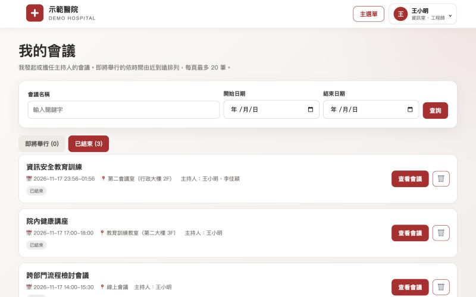
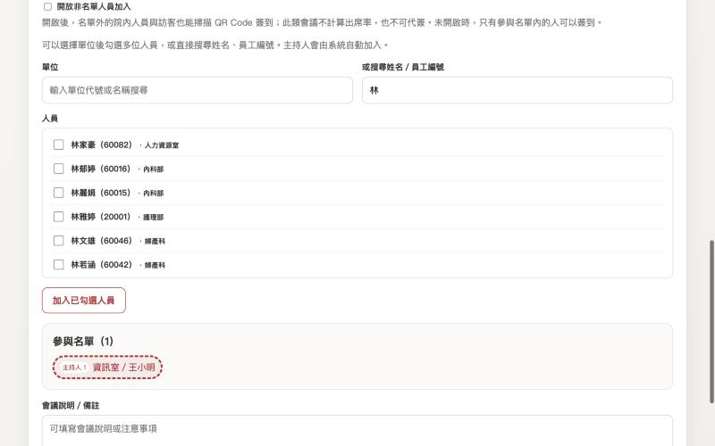
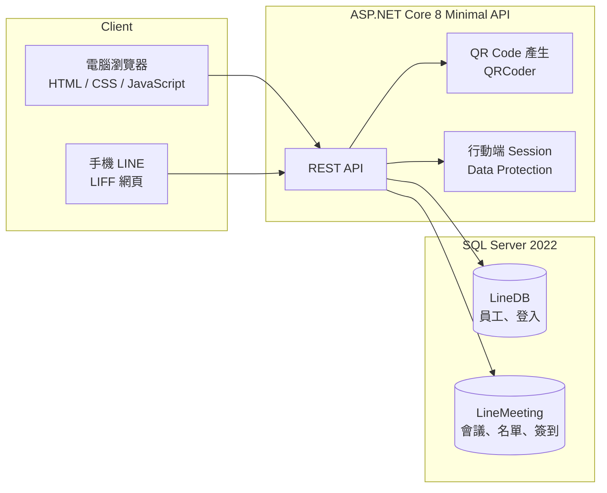

# 會議簽到系統 Meeting Check-in System

醫院內部會議的建立、QR Code 簽到／簽退與出席管理系統。主持人在電腦端建立會議、投影 QR Code，與會者用手機 LINE 掃碼完成簽到，會後可直接匯出簽到單。

> 本專案源自我在醫院資訊室實習期間（2026 年 7–8 月）**獨立開發**的系統，從需求訪談、資料庫串接、前後端實作、LINE 整合到全院操作手冊皆由我一人完成。經院方同意後，以去識別化版本公開：已移除醫院名稱、標誌、內網設定與所有連線資訊，並以模擬資料庫取代院內 HIS 資料庫，讓專案可以在任何電腦上執行。

| | |
|---|---|
|  |  |
| 主選單 | 我的會議（即將舉行／已結束） |
|  |  |
| 會議資料與出席狀況 | 會議 QR Code（已結束時自動停用） |
|  |  |
| 簽到名單與匯出 | 發起會議：跨單位搜尋參與人員 |

## 功能

**電腦端（主持人）**
- 帳號登入，主選單顯示今日會議概況
- 發起會議：會議名稱、時間、地點（院內會議室或自行填寫）、最多 3 位主持人
- 參與人員：依單位勾選多人，或跨單位直接搜尋姓名／員工編號
- 兩種參與方式：**固定名單**（只有名單內人員可簽到、可代簽、計算出席率）或**開放加入**（名單外人員與訪客也可簽到）
- 會議 QR Code：可事先列印或現場投影，會議結束後自動提示並停用
- 簽到名單：補登／修改簽到簽退時間、出席狀況、代理人與未出席原因
- 匯出 Excel（前端自行產生 .xlsx，不依賴套件）、列印或另存 PDF
- 我的會議：分「即將舉行／已結束」，依關鍵字與日期查詢

**手機端（與會者）**
- 掃描會議 QR Code 進入簽到頁，顯示會議資訊與本人身分
- 本人簽到、簽退；固定名單會議可替同事代簽
- 未綁定院內身分者以訪客身分填寫單位、姓名、職稱後簽到

> **身分辨識目前的狀態**：院方版本由醫院既有的 LINE 平台完成身分辨識，再將使用者代號帶入本系統。公開版本不依附該平台，LINE Login 與 LIFF 的串接改寫中（見「已知限制與後續規劃」）。在此之前，可用下方的開發測試模式完整體驗手機簽到流程。

## 業務規則

| 規則 | 說明 |
|---|---|
| 簽到時間 | 會議開始前 N 分鐘開放（`CheckIn:OpenMinutesBeforeStart`，預設 15），會議結束即停止簽到 |
| 簽退時間 | 簽到後可簽退，至會議結束後 30 分鐘截止 |
| 出席率 | 固定名單：名單內實到 ÷ 名單人數；開放加入：只統計實到人數，不計算出席率 |
| 代簽 | 僅限固定名單會議，代簽人須為本次會議的院內參與者 |
| 修改名單 | 已有簽到紀錄的人不能從名單移除，避免連帶刪除簽到資料 |

## 技術架構



| 層級 | 使用技術 |
|---|---|
| 後端 | C#、ASP.NET Core 8 Minimal API、ADO.NET（Microsoft.Data.SqlClient）、預存程序 |
| 資料庫 | SQL Server 2022（兩個資料庫，含跨資料庫查詢） |
| 前端 | 原生 HTML／CSS／JavaScript，無框架 |
| 外部整合 | LINE LIFF（手機簽到身分）、QRCoder |
| 開發環境 | Docker Compose（SQL Server 與初始化腳本）、.NET user-secrets |

**資料庫結構**（`db/01-schema.sql`）

| 資料庫 | 資料表／程序 | 用途 |
|---|---|---|
| LineDB | `UserInfo`、`LoginAccount` | 員工資料、登入帳號（密碼加鹽雜湊） |
| LineDB | `Login_Check`、`GetEmployee` | 登入驗證、部門與人員查詢 |
| LineMeeting | `Meeting` | 會議資料、QR Token、參與方式 |
| LineMeeting | `MeetingParticipant` | 參與名單（院內人員／訪客） |
| LineMeeting | `MeetingAttendance` | 簽到、簽退、代簽紀錄 |
| LineMeeting | `RoomInfo` | 會議室 |

**安全性設計**
- 所有 SQL 皆使用參數化查詢，防止 SQL Injection
- 應用程式以最小權限帳號 `meeting_app` 連線，無法直接讀取密碼雜湊
- 連線字串、LIFF ID 等設定不進版控，使用環境變數或 user-secrets
- 手機端身分以伺服器簽發、加密的 Session 保存

## 在本機執行

**需求**：[.NET 8 SDK](https://dotnet.microsoft.com/download/dotnet/8.0)、[Docker Desktop](https://www.docker.com/products/docker-desktop/)
（Apple Silicon 的 Mac 需在 Docker Desktop 設定中開啟 Rosetta，SQL Server 只提供 x86 映像檔。）

```bash
# 1. 設定資料庫密碼（8 碼以上，需含大小寫、數字與符號；整段替換，不保留角括號）
cp .env.example .env
#    編輯 .env 中的 MSSQL_SA_PASSWORD 與 APP_DB_PASSWORD

# 2. 啟動 SQL Server，自動建立資料表、預存程序與示範資料
docker compose up -d
docker compose logs db-init        # 最後一行出現 "Database ready." 即完成

# 3. 設定應用程式連線字串（密碼與 APP_DB_PASSWORD 相同）
dotnet user-secrets set "ConnectionStrings:LineDb" 'Server=localhost,1433;Database=LineDB;User Id=meeting_app;Password=<APP_DB_PASSWORD>;Encrypt=True;TrustServerCertificate=True'
dotnet user-secrets set "ConnectionStrings:LineMeetingDb" 'Server=localhost,1433;Database=LineMeeting;User Id=meeting_app;Password=<APP_DB_PASSWORD>;Encrypt=True;TrustServerCertificate=True'

# 4. 啟動
dotnet run
```

開啟 http://localhost:5080 ，使用示範帳號登入：

| 帳號 | 密碼 | 身分 |
|---|---|---|
| DEMO01 | Demo@1234 | 王小明，資訊室工程師（示範會議的主持人） |
| DEMO02 | Demo@1234 | 林雅婷，護理部護理長 |
| DEMO03 | Demo@1234 | 陳志豪，內科部主治醫師 |

示範資料包含 20 個單位、120 位員工、10 間會議室，以及進行中、已結束（固定名單與開放加入各一）、即將舉行的會議，人名皆為虛構。

**測試手機簽到（開發測試模式）**：在 Development 環境下，可直接開啟
`http://localhost:5080/mobile-checkin.html?token=<會議 QR Token>&testEmployeeId=10001`
（以員工身分）或改用 `&testGuest=1`（以訪客身分）。QR Token 可用下列指令查詢：

```bash
docker exec meeting-checkin-db /opt/mssql-tools18/bin/sqlcmd -C -S localhost -U meeting_app \
  -P "$(grep '^APP_DB_PASSWORD=' .env | cut -d= -f2)" -d LineMeeting \
  -Q "SELECT MeetingNo, MeetingName, QRCode FROM dbo.Meeting"
```

**串接 LINE（改寫完成後適用）**：在 LINE Developers 建立 LINE Login channel 與 LIFF app，將 LIFF ID 與 Channel ID 設定為 `LineLiff:LiffId`、`LineLiff:ChannelId`；本機開發可用 ngrok 等工具提供 HTTPS 網址，設定為 `PublicBaseUrl` 並填入 LIFF 的 Endpoint URL。未設定 LIFF 時，QR Code 會直接指向本機的手機簽到入口。

## 專案結構

```
├── Program.cs               # API、業務規則、資料存取
├── appsettings.json         # 不含機敏資料的預設設定
├── docker-compose.yml       # SQL Server + 初始化
├── db/
│   ├── 01-schema.sql        # 資料庫、資料表、預存程序、最小權限帳號
│   └── 02-seed.sql          # 示範資料（可重複執行）
└── wwwroot/
    ├── index.html           # 登入
    ├── dashboard.html       # 主選單
    ├── sign-in.html         # 今日會議
    ├── create-meeting.html  # 發起／修改會議
    ├── my-meetings.html     # 我的會議
    ├── meeting-detail.html  # 會議資料
    ├── qr.html              # 會議 QR Code
    ├── attendance.html      # 簽到名單、匯出
    ├── liff-entry.html      # LINE LIFF 入口
    ├── mobile-checkin.html  # 手機簽到
    └── app.js / app.css     # 共用元件與樣式
```

## 從院方版本到個人版本

院方版本依當時的環境與需求設計；公開版本在去識別化之外，也重新檢視了流程與規則：

| 項目 | 院方版本 | 個人版本 |
|---|---|---|
| 資料庫 | 院內 HIS 資料庫 | Docker 模擬資料庫，一行指令建立 |
| 機敏設定 | 寫在設定檔中 | 環境變數／user-secrets，不進版控 |
| 內網限制 | 寫死院內網段與電腦命名規則 | 改為可設定，預設關閉 |
| 開放簽到時間 | 會議開始時才開放 | 可設定提前開放（預設 15 分鐘） |
| 修改參與名單 | 移除人員會一併刪除其簽到紀錄 | 已簽到者不可移除，保護紀錄 |
| 出席率 | 以建立時記錄的人數為分母 | 依參與方式即時計算 |
| 會議 QR Code | 只能從「今日會議」開啟 | 任何會議都可事先開啟、列印 |
| 加入參與人員 | 只能逐一單位勾選 | 可跨單位搜尋姓名或員工編號 |
| LINE 身分辨識 | 由醫院的 LINE 平台帶入使用者代號 | 改為 LIFF ID Token 驗證（進行中） |

## 已知限制與後續規劃

- **電腦端身分驗證**：目前登入後由前端保存使用者身分並隨 API 傳送，預計改為伺服器端 Cookie 驗證，由後端判斷使用者身分與權限。
- **LINE 串接（進行中）**：院方版本依其規格，由醫院的 LINE 平台將使用者代號透過網址傳入，本系統直接採信。公開版本改寫為標準做法：前端以 LIFF 取得 ID Token，後端呼叫 LINE 的驗證 API 後取得使用者代號，網址不再夾帶身分。完成前，手機簽到僅能以開發測試模式體驗。
- **程式結構**：後端目前集中於 `Program.cs`，預計拆分為 Endpoints、Services、Data Access 等層。
- **自動化測試與 CI**：預計加入簽到時間、出席率等規則的單元測試，並以 GitHub Actions 自動建置與測試。
