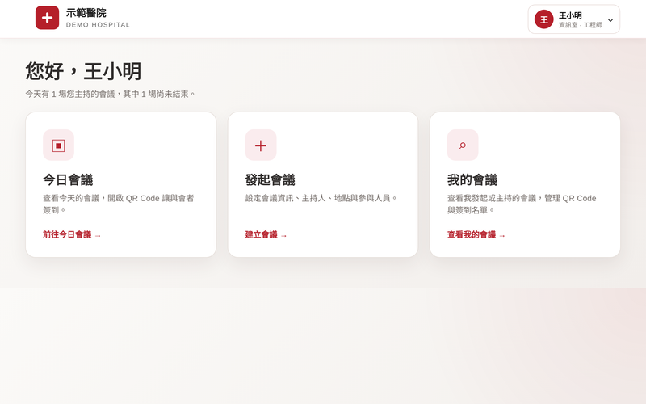
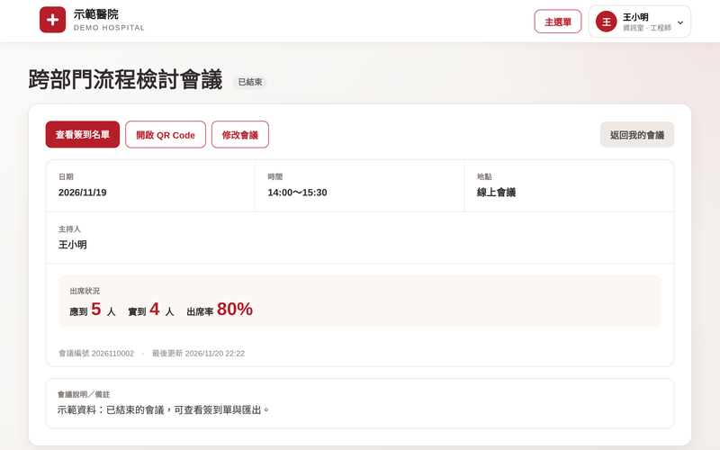
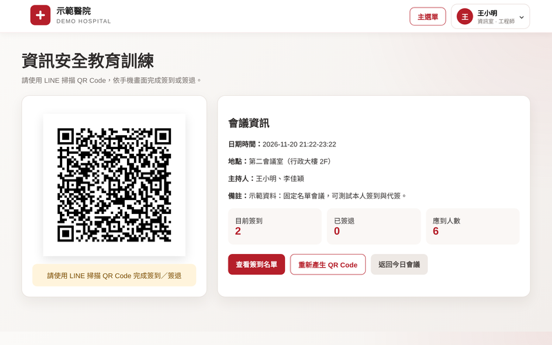
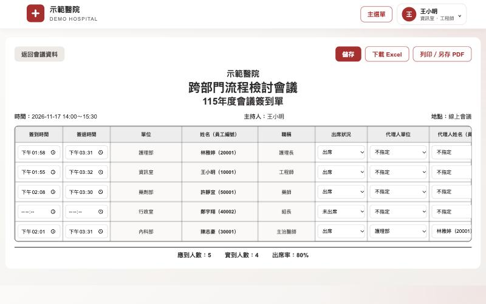
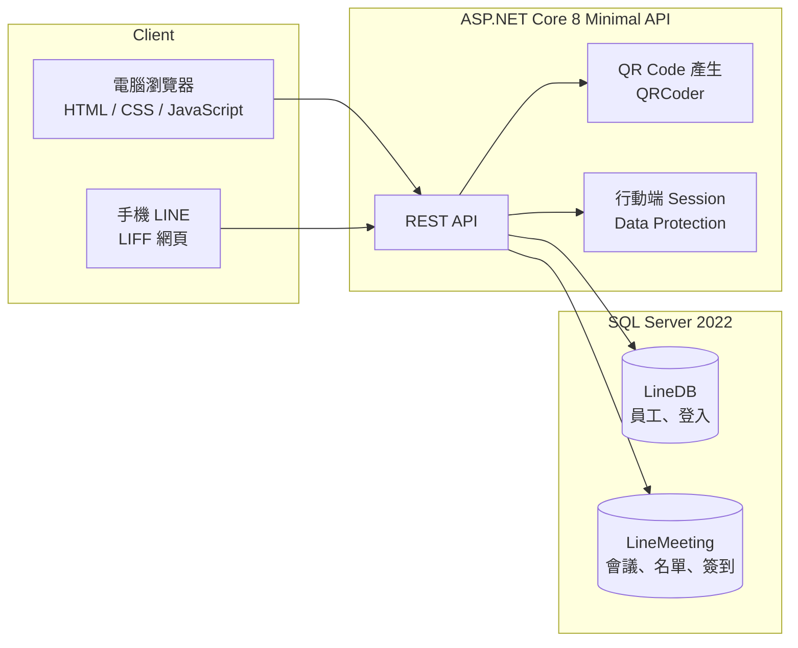

# 會議簽到系統 Meeting Check-in System

醫院內部會議的建立、QR Code 簽到／簽退與出席管理系統。主持人在電腦端建立會議、投影 QR Code，與會者用手機 LINE 掃碼完成簽到，會後可直接匯出簽到單。

> 本專案源自我在醫院資訊室實習期間（2026 年 7–8 月）**獨立開發**的系統，從需求訪談、資料庫串接、前後端實作、LINE 整合到全院操作手冊皆由我一人完成。經院方同意後，以去識別化版本公開：已移除醫院名稱、標誌、內網設定與所有連線資訊，並以模擬資料庫取代院內 HIS 資料庫，讓專案可以在任何電腦上執行。

| | |
|---|---|
|  |  |
| 主選單 | 我的會議 |
|  |  |
| 會議資料與出席狀況 | 會議 QR Code（外流時可重新產生，舊碼立即失效） |
|  |  |
| 簽到名單與匯出 | 發起會議：跨單位搜尋參與人員 |

## 功能

**電腦端（主持人）**
- 帳號登入，主選單顯示今日會議概況
- 發起會議：會議名稱、時間、地點（院內會議室或自行填寫）、最多 3 位主持人
- 參與人員：依單位勾選多人，或跨單位直接搜尋姓名／員工編號
- 兩種參與方式：**固定名單**（只有名單內人員可簽到、可代簽、計算出席率）或**開放加入**（名單外人員與訪客也可簽到）
- 會議 QR Code：可事先列印或現場投影，會議結束後自動提示並停用
- 簽到名單：補登／修改簽到簽退時間、出席狀況、代理人與未出席原因
- 匯出 Excel（前端自行產生 .xlsx，不依賴套件）、列印或另存 PDF
- 我的會議：列出自己發起或主持的會議（進行中與即將舉行在前），依關鍵字與日期查詢
- QR Code 外流時可重新產生，舊碼與用舊碼進入的手機畫面立即失效

**手機端（與會者）**
- 掃描會議 QR Code 進入簽到頁，顯示會議資訊與本人身分
- 本人簽到、簽退；固定名單會議可替同事代簽
- 開放加入的會議中，未綁定院內身分者以訪客身分填寫單位、姓名、職稱後簽到

> **身分辨識**：手機端以 LINE LIFF 取得 ID Token，後端向 LINE 驗證後得到使用者代號，再對應到已綁定的員工。實際在醫院使用時，員工事先與醫院 LINE 官方帳號綁定，未綁定者由資訊室從後台處理；公開版本為了能獨立展示，提供以示範帳號密碼自行綁定的畫面。

## 業務規則

| 規則 | 說明 |
|---|---|
| 簽到時間 | 會議開始前 N 分鐘開放（`CheckIn:OpenMinutesBeforeStart`，預設 15），會議結束即停止簽到 |
| 簽退時間 | 簽到後可簽退，至會議結束後 N 分鐘截止（`CheckIn:CloseMinutesAfterEnd`，預設 30） |
| 時間基準 | 程式與資料庫一律使用台北時間（`AppClock`、`dbo.AppNow()`），部署到其他時區的主機也不會偏移 |
| 出席率 | 固定名單：名單內實到 ÷ 名單人數；開放加入：只統計實到人數，不計算出席率 |
| 代簽 | 僅限固定名單會議，代簽人須為本次會議的院內參與者 |
| 修改名單 | 已有簽到紀錄的人不能從名單移除，避免連帶刪除簽到資料 |
| 修改會議 | 有人簽到後不能改日期；會議結束後主持人、參與名單、開放設定鎖定（名稱、時間、地點、備註仍可改） |
| 同時編輯 | 會議帶版本號（rowversion），兩人同時編輯時後存的會被擋下，不會互相覆蓋 |
| 刪除會議 | 只有建立者能刪除，且必須尚無人簽到；刪除為標記刪除，資料保留 |
| 未出席原因 | 記在參與名單上，只有未出席者可填；簽到後自動清除 |
| 重新產生 QR Code | 會議結束前，主持人可重新產生；舊碼與用舊碼取得的手機憑證立即失效，已完成的簽到不受影響 |

## 技術架構



| 層級 | 使用技術 |
|---|---|
| 後端 | C#、ASP.NET Core 8 Minimal API、ADO.NET（Microsoft.Data.SqlClient）、預存程序 |
| 資料庫 | SQL Server 2022（兩個資料庫，含跨資料庫查詢） |
| 前端 | 原生 HTML／CSS／JavaScript，無框架 |
| 外部整合 | LINE LIFF（手機簽到身分）、QRCoder |
| 測試與 CI | xUnit 單元測試；GitHub Actions 自動建置、測試，並在 SQL Server 容器中驗證建表與示範資料腳本 |
| 開發環境 | Docker Compose（SQL Server 與初始化腳本）、.NET user-secrets |

**資料庫結構**（`db/01-schema.sql`）

| 資料庫 | 資料表／程序 | 用途 |
|---|---|---|
| LineDB | `UserInfo`、`LoginAccount` | 員工資料、登入帳號（密碼加鹽雜湊） |
| LineDB | `Login_Check`、`GetEmployee` | 登入驗證、部門與人員查詢 |
| LineMeeting | `Meeting` | 會議資料、QR Token、參與方式 |
| LineMeeting | `MeetingParticipant` | 參與名單（院內人員／訪客） |
| LineMeeting | `MeetingAttendance` | 簽到、簽退、代簽紀錄 |
| LineMeeting | `MeetingAttendanceLog` | 簽到紀錄修改歷程（由觸發程序寫入，程式帳號不能改） |
| LineMeeting | `RoomInfo` | 會議室 |

**安全性設計**
- 所有 SQL 皆使用參數化查詢，防止 SQL Injection
- 簽到紀錄的新增、修改、刪除都由觸發程序寫入修改歷程，記錄操作者與來源（簽到單／手機／代簽）；應用程式帳號對歷程表沒有寫入權限
- 應用程式以最小權限帳號 `meeting_app` 連線，無法直接讀取密碼雜湊
- 連線字串、LIFF ID 等設定不進版控，使用環境變數或 user-secrets
- 手機端身分以伺服器簽發、加密的 Session 保存；每次操作都比對會議目前的 QR Token 與結束時間，主持人延長會議時自動延長，重新產生 QR Code 時立即失效
- 加密金鑰存在固定資料夾（`DataProtection:KeysPath`），重新部署後手機 Session 仍有效
- 電腦端以伺服器簽發的 HttpOnly Cookie 驗證身分；所有 API 預設需要登入，只有登入、LINE 與手機簽到相關端點例外
- 同一帳號 15 分鐘內登入失敗 5 次即暫時鎖定（電腦登入與 LINE 綁定共用計數）
- 簽到單存檔時比對開啟當下的原始值，若期間有人在手機上簽到或簽退，就拒絕存檔，避免覆蓋新紀錄
- 開發測試端點只接受本機直接連線，經 ngrok 等代理轉發的請求一律拒絕
- 健康檢查 API 不需登入，因此只回傳正常／異常，錯誤細節只寫入伺服器紀錄

**多人同時使用**
- 會議編號、QR Token 在 Serializable 交易中產生並檢查唯一性；同一場會議的簽到依序處理，避免同一人重複簽到
- 交易遇到資料庫死結時自動重試（最多 3 次），使用者不會看到錯誤

## 在本機執行

**需求**：[.NET 8 SDK](https://dotnet.microsoft.com/download/dotnet/8.0)、[Docker Desktop](https://www.docker.com/products/docker-desktop/)
（Apple Silicon 的 Mac 需在 Docker Desktop 設定中開啟 Rosetta，SQL Server 只提供 x86 映像檔。）

```bash
# 1. 設定資料庫密碼（8 碼以上，需含大小寫、數字與符號；整段替換，不保留角括號）
cp .env.example .env
#    編輯 .env 中的 MSSQL_SA_PASSWORD 與 APP_DB_PASSWORD

# 2. 啟動 SQL Server，自動建立資料表、預存程序與示範資料
docker compose up -d
docker compose logs db-init        # 最後一行出現 "Database ready." 即完成

# 3. 設定應用程式連線字串（密碼與 APP_DB_PASSWORD 相同）
dotnet user-secrets set "ConnectionStrings:LineDb" 'Server=localhost,1433;Database=LineDB;User Id=meeting_app;Password=<APP_DB_PASSWORD>;Encrypt=True;TrustServerCertificate=True'
dotnet user-secrets set "ConnectionStrings:LineMeetingDb" 'Server=localhost,1433;Database=LineMeeting;User Id=meeting_app;Password=<APP_DB_PASSWORD>;Encrypt=True;TrustServerCertificate=True'

# 4. 啟動
dotnet run

# 執行單元測試
dotnet test tests/MeetingCheckin.Tests
```

開啟 http://localhost:5080 ，使用示範帳號登入：

| 帳號 | 密碼 | 身分 |
|---|---|---|
| DEMO01 | Demo@1234 | 王小明，資訊室工程師（示範會議的主持人） |
| DEMO02 | Demo@1234 | 林雅婷，護理部護理長 |
| DEMO03 | Demo@1234 | 陳志豪，內科部主治醫師 |

示範資料包含 20 個單位、120 位員工、10 間會議室，以及進行中、已結束（固定名單與開放加入各一）、即將舉行的會議，人名皆為虛構。

**測試手機簽到（開發測試模式）**：在 Development 環境下，可直接開啟
`http://localhost:5080/mobile-checkin.html?source=dev&token=<會議 QR Token>&testEmployeeId=10001`
（以員工身分）或改用 `&testGuest=1`（以訪客身分）。QR Token 可用下列指令查詢：

```bash
docker exec meeting-checkin-db /opt/mssql-tools18/bin/sqlcmd -C -S localhost -U meeting_app \
  -P "$(grep '^APP_DB_PASSWORD=' .env | cut -d= -f2)" -d LineMeeting \
  -Q "SELECT MeetingNo, MeetingName, QRCode FROM dbo.Meeting"
```

**串接 LINE**：在 LINE Developers 建立 LINE Login channel 與 LIFF app，將 LIFF ID 與 Channel ID 設定為 `LineLiff:LiffId`、`LineLiff:ChannelId`；本機開發可用 ngrok 等工具提供 HTTPS 網址，設定為 `PublicBaseUrl` 並填入 LIFF 的 Endpoint URL。未設定 LIFF 時，QR Code 會直接指向本機的手機簽到入口。

## 專案結構

```
├── Program.cs                 # 啟動設定：驗證、中介層、靜態檔案，並掛上各組 API
├── Endpoints/                 # API，依功能分檔
│   ├── AuthEndpoints.cs       #   登入、登出、目前使用者
│   ├── MeetingEndpoints.cs    #   會議的建立、修改、查詢、刪除
│   ├── AttendanceEndpoints.cs #   簽到名單、手機簽到／簽退、代簽
│   ├── LineEndpoints.cs       #   LIFF 驗證、綁定、訪客資料、開發測試端點
│   ├── QrEndpoints.cs         #   QR Code 圖片與重新產生
│   ├── DirectoryEndpoints.cs  #   單位、人員、會議室查詢
│   └── SystemEndpoints.cs     #   健康檢查、院內電腦判斷
├── Domain/                    # 業務規則（不碰資料庫，可單元測試）
│   ├── CheckInRules.cs        #   簽到／簽退時間窗
│   ├── MeetingEditRules.cs    #   修改與刪除會議的限制、版本檢查
│   ├── LoginThrottle.cs       #   登入失敗次數限制
│   ├── MeetingTokens.cs       #   QR Token、訪客代號
│   └── Participants.cs        #   名單列識別值、時間解析
├── Mobile/MobileSession.cs    # 手機簽到憑證的簽發與檢查
├── Infrastructure/            # 資料庫輔助、死結重試、台北時間、請求來源判斷
├── Contracts/Requests.cs      # API 請求格式
├── tests/MeetingCheckin.Tests # xUnit 單元測試
├── .github/workflows/ci.yml   # GitHub Actions
├── docker-compose.yml         # SQL Server + 初始化
├── db/
│   ├── 01-schema.sql          # 資料庫、資料表、觸發程序、最小權限帳號
│   └── 02-seed.sql            # 示範資料（可重複執行）
└── wwwroot/                   # 前端頁面（登入、主選單、會議、QR Code、簽到名單、手機簽到）
```

## 從院方版本到個人版本

院方版本依當時的環境與需求設計；公開版本在去識別化之外，也重新檢視了流程與規則：

| 項目 | 院方版本 | 個人版本 |
|---|---|---|
| 資料庫 | 院內 HIS 資料庫 | Docker 模擬資料庫，一行指令建立 |
| 機敏設定 | 寫在設定檔中 | 環境變數／user-secrets，不進版控 |
| 內網限制 | 寫死院內網段與電腦命名規則 | 改為可設定，預設關閉 |
| 開放簽到時間 | 會議開始時才開放 | 可設定提前開放（預設 15 分鐘） |
| 修改參與名單 | 移除人員會一併刪除其簽到紀錄 | 已簽到者不可移除，保護紀錄 |
| 出席率 | 以建立時記錄的人數為分母 | 依參與方式即時計算 |
| 會議 QR Code | 只能從「今日會議」開啟 | 任何會議都可事先開啟、列印 |
| 加入參與人員 | 只能逐一單位勾選 | 可跨單位搜尋姓名或員工編號 |
| LINE 身分辨識 | 由醫院的 LINE 平台帶入使用者代號 | 改為 LIFF ID Token 由後端向 LINE 驗證 |
| 程式結構 | 單一 `Program.cs` | 依功能拆分，業務規則獨立並有單元測試 |
| 時間 | 混用主機與資料庫時鐘 | 統一為台北時間 |

## 已知限制與後續規劃

- **登入失敗次數**：記錄在伺服器記憶體中，重啟後歸零，也無法在多台伺服器間共用；正式環境應改存於資料庫或共用快取。
- **QR Token 格式**：沿用醫院既有規格（`M-` 加 32 碼 MD5 十六進位）。MD5 只用來產生固定長度的字串，無法猜測的部分來自 GUID 的隨機值，並非以 MD5 保護資料。
- **參與者的檢視範圍**：依院方需求，電腦端只有發起人與主持人看得到會議；受邀者透過手機掃碼簽到。
- **測試範圍**：單元測試涵蓋業務規則與身分驗證邏輯，資料庫腳本由 CI 實際執行驗證；API 層的整合測試尚未加入。
